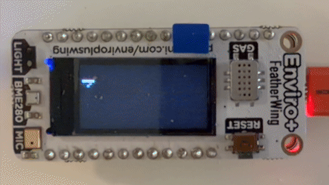

# Enviro+ FeatherWing on a Feather HUZZAH (ESP8266)

The parts of [EnviroPlus-FeatherWing](https://github.com/pimoroni/EnviroPlus-FeatherWing) needed to run the wing on an Adafruit Feather HUZZAH ESP8266 with CircuitPython 3.1.2. The main repo has dropped ESP8266 support, so this project carries its own copies.



The screen rotates every 15 seconds through the readout in C, the readout in F, the network view (IP address, device name and request count) and a 24-hour graph of temperature, humidity, pressure and light.

## Layout

```
huzzah.sh          Flash, list, copy, run and reset the board (uses esptool-env and mpremote)
setup.sh           Creates esptool-env and installs requirements.txt
requirements.txt   Pinned esptool, ampy and mpremote versions
esptool-env/       Python venv with esptool, ampy and mpremote (made by setup.sh, not committed)
firmware/          CircuitPython 3.1.2 for the HUZZAH, and flashing notes
device/            Mirrors the CIRCUITPY drive. Copy these to the board.
  boot.py
  code.py          Boot readout: shows the current temperature, humidity and pressure on the screen, then starts the HTTP server
  http_server.py   Serves the readings as JSON on GET / (needs wifi_config.py; see the limits at the top of the file)
  bme280_min.py    Minimal BME280 driver for temperature and humidity (the full library doesn't fit in RAM)
  st7735.py        Minimal ST7735 driver (CircuitPython 3.x has no displayio)
  Screen.py, I2C.py, BME280_*.py, Light.py, Prox.py, Mic.py   Individual sensor tests, run by examples/test_runner.py
  lib/
    adafruit_bme280/              BME280 driver, patched for CircuitPython 3.x (see below)
    adafruit_bus_device/          i2c_device.py, used by adafruit_bme280, patched the same way
    pimoroni_circuitpython_adapter/  SMBus-style wrapper around busio.I2C
    pimoroni_ltr559/              Minimal LTR559 light and proximity driver
examples/          Standalone scripts, run with ./huzzah.sh run
  screen_test.py     Screen test, runs on its own
  bme280_simple.py   BME280 reading, runs on its own
  test_runner.py     Runs the sensor tests in turn, one per boot (see Setup)
  wifi_scan.py       Lists access points in range, used by ./huzzah.sh wifi scan
  security_check.py  Checks the board's own security settings (run with ./huzzah.sh run)
tools/
  security_test.py   Network security tests for the HTTP server, run from the computer
LICENSE            MIT licence for this project
licenses/          Licence texts for the copied code
```

## Licence

This project is MIT licensed (see [LICENSE](LICENSE)). The copied libraries under `device/lib/` and the other upstream code keep their own MIT notices in [licenses/](licenses/).

## Setup

Needs Python 3 on the machine. The `esptool-env/` venv is not copied with the project, so build it first.

1. Create the virtual environment and install the pinned tools:

   ```bash
   ./setup.sh
   ```

   This creates `esptool-env/` if it is missing and installs `requirements.txt` into it. Running it again is safe. To rebuild from scratch, run `./setup.sh --recreate`. To use a specific interpreter, run `PYTHON=python3.14 ./setup.sh`.

2. Flash CircuitPython 3.1.2 (erases the board):

   ```bash
   ./huzzah.sh flash
   ```

3. Copy the device files. This copies every `.py` under `device/` to the board, including `lib/`, and creates the folders it needs. Existing files are overwritten; nothing is deleted:

   ```bash
   ./huzzah.sh load
   ```

   It copies one file at a time, so it takes a while.

4. Reset the board. `code.py` shows the current temperature and humidity on the screen.

To run the sensor tests, use `./huzzah.sh run examples/test_runner.py`. It resets the board between tests and writes to flash, so use it on purpose.

## Security

The board serves its readings at `http://<board>/` as JSON, with no login, to anyone on the same network. That is by design: the readings aren't secret. The aim of the security work is that the server gives away nothing else, can't be used to get onto the board, and keeps answering when a client misbehaves.

### Running the security tests

There are two tools. Run both after any change to `device/http_server.py` or to the WiFi setup.

**Network tests, from the computer** (`tools/security_test.py`, standard library only, no venv needed):

```bash
python3 tools/security_test.py enviro          # the board, by its network name or IP address
python3 tools/security_test.py enviro --full   # also checks the rate limit resets (adds about a minute)
python3 tools/security_test.py --emulate       # runs device/http_server.py on this computer with a fake sensor
```

`--emulate` needs no board. It checks the server's logic on 127.0.0.1, not the ESP8266's network stack, so use it while editing and test the board before trusting a change. The checks take about 10 seconds. They use most of the server's per-client rate limit, then trip it on purpose, so a second run within a minute first waits for the limit to reset. The expected limits are read from `device/http_server.py`, so load the same version onto the board first (`./huzzah.sh load`).

| Check | What it does | Passes when |
|---|---|---|
| open ports | Connects to 21, 22, 23, 443, 8080 and 8266 (WebREPL) | All are closed. An open 23 or 8266 is a FAIL, since it would give a Python prompt |
| baseline GET / | Fetches the readings | 200, exactly the three numeric keys, correct Content-Length, `Cache-Control: no-store`, `X-Content-Type-Options: nosniff`, no `Server` or CORS header |
| other methods | POST with a body, TRACE | 405 with `Allow: GET`, and the request isn't echoed back |
| other paths | `/wifi_config.py`, `/../wifi_config.py`, an encoded traversal with a script tag | 404, and no file contents or request text in the reply |
| malformed requests | TLS-style binary, HTTP/0.9, badly spaced request line | 400 |
| oversized request | 4 KB of headers | 431, or the connection is reset |
| request smuggling | A second request after a GET with a body | Exactly one reply, then the connection closes |
| Host header | `Host: attacker.example` | WARN when accepted (see accepted risks) |
| idle connection | Connects and sends nothing | Dropped within `REQUEST_TIMEOUT` (3 s) plus 1.5 s |
| slowloris | Sends one byte a second, while a second client makes a normal request | The slow client is dropped within 3 s plus 1.5 s, and the normal request is answered |
| rate limit | Repeats GET / | 429 by connection `RATE_LIMIT_REQUESTS` + 1, counting every connection made so far |
| rate limited idle connection | A limited client connects and sends nothing | Dropped within `REFUSED_TIMEOUT` (0.5 s) plus 1.5 s |
| connection flood | 10 connections at once | The server answers again within 15 s |
| rate limit recovery (`--full`) | Waits out the window | 200 again |

The exit status is 1 if any check fails and 2 if the server can't be reached, so the tests can be scripted.

**Board settings, on the board** (`examples/security_check.py`):

```bash
./huzzah.sh run examples/security_check.py
```

This stops `code.py` while it runs, so reset the board afterwards. It changes nothing and never prints the WiFi password. It checks that:

- the board's own access point is off
- nothing starts WebREPL, and there's no `webrepl_cfg.py`
- the WiFi network in `wifi_config.py` uses WPA or WPA2, not open or WEP
- the board's `http_server.py` has the fixes below and sane limits
- no unexpected files are on the board, such as a `main.py`

### Security status

Reviewed and tested on hardware on 2026-10-31. Status: **all checks pass on the board.**

| Tool | Target | Result |
|---|---|---|
| `tools/security_test.py <board-ip> --full` | Feather HUZZAH, CircuitPython 3.1.2, on a WPA2 network | 19 passed, 1 warning (the accepted Host header risk), 0 failed |
| `tools/security_test.py --emulate` | `device/http_server.py` on the computer | 13 passed with `--full`, 1 warning, 0 failed |
| `./huzzah.sh run examples/security_check.py` | The same board | 4 passed: access point off, no WebREPL, WPA2-PSK, current `http_server.py` |

On the board, the slow client and the idle client were each dropped after 3.0 s. A normal request made during the slow-client attack was answered in about 2 s. A rate limited client was dropped after 0.5 s, and the server answered again 0.1 s after 10 connections at once. The version before the review fails 5 checks on the emulator: missing nosniff header, slowloris (2 checks), rate limit, and rate limited idle connection.

Two things seen on the board, neither a security problem:

- The board's network stack (lwIP) resets a connection that is closed with request data still unread, as in the oversized and smuggled-request tests. The computer may then drop the reply. The tests accept a reset there, because the extra data was still never acted on.
- After `./huzzah.sh run` or `./huzzah.sh reset`, the server sometimes doesn't come back (`Connection refused` on port 80). Press the board's reset button, then wait about 20 seconds for it to join WiFi.

Run both tools again after any change to `device/http_server.py`. `./huzzah.sh load` doesn't restart the server, so reset the board first. `security_check.py` reads the file, not the copy that's running.

**Found and fixed:**

| # | Severity | Finding | Fix |
|---|---|---|---|
| 1 | High | **Slowloris.** `REQUEST_TIMEOUT` applied to each 64-byte read, not to the whole request. A client sending one byte every 2 seconds could hold the single-client server for about 25 minutes (512 bytes × 3 s), so nobody else got a reading. | The timeout now covers the whole request, and the reply has its own limit. |
| 2 | Medium | **Rate limit skipped idle clients.** The limit was checked only after a full request arrived. Connections that sent nothing, or timed out, were never counted, so they could hold the server without limit. | Every accepted connection is counted before anything is read. A client over its limit gets 0.5 s instead of 3 s. |
| 3 | Medium | **Board's own access point.** `boot.py` is MicroPython's first-boot template. That first boot normally turns on an access point called `MicroPython-xxxxxx` with the published password `micropythoN`. The server listens on every interface, so anyone in range could join that access point and reach it. | `connect_wifi()` turns the access point off before anything else, even without `wifi_config.py`. It only writes flash when the access point was on. `security_check.py` reports it. This board's access point was off when checked, so it's not known whether it had been on. |
| 4 | Low | **Clock going backwards.** If `time.monotonic()` ever went back, rate limit entries and the cached reading would never expire. That would lock every client out once 16 were tracked, and serve a stale reading forever. | `seconds_since()` treats a negative interval as long ago. |
| 5 | Low | **WiFi scan output.** Access point names come from any device in range. A name with a newline or escape codes could add fake entries to the `huzzah.sh wifi scan` list, or rewrite the terminal. | `wifi_scan.py` skips names with control characters. Use `wifi set` for such a network. |
| 6 | Info | No `X-Content-Type-Options` header. | Added `nosniff`. |

**Checked and found sound:** no request data is echoed into replies, so there's no header injection or XSS. Only `GET /` returns data, and no file is ever served, so path traversal can't reach `wifi_config.py`. Error replies are fixed strings, and exceptions go to the serial console, not the client. Request size, client table, and backlog are all bounded, so memory can't grow with requests. Each connection gets one reply, then closes, so pipelined or smuggled requests are ignored. There's no CORS header, so other web pages can't read the reply. There's no `Server` header or version string.

**Accepted risks** (inherent to the hardware or the purpose):

- **Plain HTTP, no login.** Anyone on the network can read the readings, and anyone on the path can see or change them in transit. The ESP8266 on CircuitPython 3.x can't serve TLS, and the readings aren't secret. Don't use this server's numbers to control anything safety-relevant.
- **DNS rebinding.** Any `Host` header is accepted, so a malicious web page could read the readings through a visitor's browser. Checking the Host header would need the network's DNS suffix, and the data isn't sensitive. The tests report this as a WARN.
- **Single client, small limits.** One device on the network can still keep the server busy, though no longer indefinitely. A client limited to 20 requests a minute that keeps reconnecting gets 0.5 s of server time each time. Filling the 16-client table from many addresses locks new clients out for up to a minute. A board this size can't do better, so put it on a trusted network.
- **Physical access is full access.** The USB serial console has no password. `wifi_config.py` holds the WiFi password in plain text, and `./huzzah.sh get wifi_config.py` reads it. The ESP8266 has no secure storage. Keep the board somewhere trusted, and consider a guest or IoT network for it.
- **Password on the command line.** `./huzzah.sh wifi set SSID PASSWORD` leaves the password in shell history. `./huzzah.sh wifi scan` prompts for it without echoing, so prefer that.
- **WiFi doesn't reconnect.** If the access point drops, the server stays down until the board is reset. That's an availability gap, not an exposure.

## Challenges on the way

The project was built in a hardware loop: each change was flashed, then checked on the screen or with `curl`. Some of the problems that came up:

- **Text cut off and blank rows.** The first temperature line drew only one pixel row, and the layout needed several fixes before temperature and humidity both showed on the 160x80 panel.
- **Wi-Fi scan failed.** The first `huzzah.sh wifi scan` run failed with `error: scan failed`. The scan then became a list to pick an access point from, with a prompt for its password.
- **Screen and server stopped on reset.** Running `./huzzah.sh reset` while the board was running stopped the screen and the web server, and `curl` got "connection reset by peer". Afterwards the server sometimes did not come back until the board's reset button was pressed.
- **Views did not rotate.** The third view was added, but the screen kept showing the last output until the rotation was fixed.
- **The graph drew only at the far right.** The first graph drew a line at the right edge rather than across the screen. Samples are now spread across the whole width until 24 hours are recorded.
- **Memory.** The ESP8266 has about 26 KB free at boot. Screen rows and reply bytes built as lists used four times the memory of the bytes they held, so they are now built in a `bytearray`. Five-minute graph samples (288) did not fit beside the server, so the graph keeps 144 ten-minute samples in RAM, and a reset starts that history again.
- **Graph blocked the server.** Drawing the graph takes about 1.5 s and blocks the server. Drawing it in steps from the idle callback caused connections to reset, so it is drawn in one go on entry to the graph view.
- **Slowloris.** The security review found that the request timeout applied to each read, so one byte every 2 seconds could hold the single-client server for about 25 minutes. The timeout now covers the whole request. See [Security status](#security-status).
- **Board's own access point.** The first-boot `boot.py` template turns on an access point with a published password, and the server listens on every interface. The server now turns that access point off before joining Wi-Fi.

## Other commands

```bash
./huzzah.sh port                          # Show the detected serial port
./huzzah.sh ls lib                        # List files on the board
./huzzah.sh run examples/bme280_simple.py # Run a script without copying it
./huzzah.sh reset
./huzzah.sh erase                         # Wipes the board (asks first)
```

The port is found from `/dev/cu.usbserial*`. Set `AMPY_PORT` to choose one when more than one is attached.

## What works on the HUZZAH

| Sensor | Status | Notes |
|---|---|---|
| BME280 (temperature, humidity, pressure) | Ported | Uses the I2C address 0x76 |
| LTR-559 (light, proximity) | Ported | Minimal driver: the full `pimoroni_ltr559` is too big for this build's RAM |
| ST7735 screen | Ported | Driven directly over SPI. It fills the panel, draws text with a 5x7 font, and dims through the backlight PWM on GPIO0 (`set_brightness`) |
| Microphone | Ported | Read from `board.ADC`, the HUZZAH's only ADC |
| MiCS6814 gas sensor | **Not supported** | Needs three analog channels. The ESP8266 has one ADC |
| PMS5003 particulate sensor | **Not supported** | `pimoroni_physical_feather_pins` has no HUZZAH pin map, so it fails at import |

`code.py` leaves out the gas and PMS5003 tests for these reasons. The gas and PMS5003 modules from the main repo are not copied here.

## Changes from the upstream libraries

- **adafruit_bme280** (from `Adafruit_CircuitPython_BME280`, the local checkout): removed function annotations and changed 8 f-strings to `%` formatting. CircuitPython 3.x can't parse either. No logic was changed.
- **adafruit_bus_device** (fetched from `main` on GitHub): kept only `__init__.py` and `i2c_device.py`, with the same annotation and f-string changes. `spi_device.py` is not needed on this board, since only I2C is used.
- **pimoroni_circuitpython_adapter**: the upstream package is `circuitpython_adapter`. It's installed under `pimoroni_circuitpython_adapter` because `Light.py` and `Prox.py` import that name.
- **huzzah.sh**: paths are resolved from the script's own folder, so the project can move.
- **code.py**: the gas and PMS5003 tests are removed (see above).

The patched libraries and the test code have been checked for syntax only. They have **not** been run on hardware yet. The HTTP server and its security fixes have been tested on a board (see [Security status](#security-status)).
